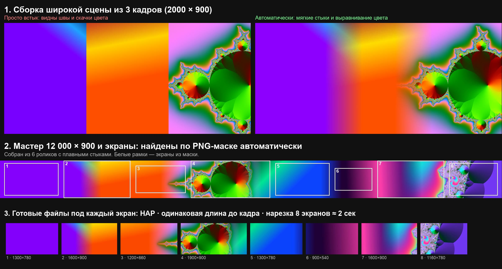

# Инструменты для видеомэппинга на ffmpeg

Два инструмента для подготовки контента под мэппинг и многоэкранные инсталляции. Обработка идёт кадр за кадром через ffmpeg, поэтому сверхшироких форматов (12 000 × 900 и больше) не боится и не требует монтажного проекта.



## `compose` — широкая сцена из нескольких роликов с мягкими стыками
Раскладывает ролики слева направо с перекрытием. Каждый следующий кусок проявляется по горизонтальному градиенту, поэтому шва не видно. Яркость и цвет кусков выравниваются (`normalize`), чтобы стыки не «прыгали».

```bash
python mapping.py compose a.mp4 b.mp4 c.mp4 -W 2000 -H 900 --overlap 300 -o scene.mp4
```

## `cut` — нарезка мастера на файлы под каждый экран
Экраны задаются **PNG-маской** (белое — экран, чёрное — фон), и скрипт находит их сам, или **JSON-картой** с координатами, родным разрешением экрана и поворотом. Все файлы режутся одним проходом ffmpeg, поэтому длина у них одинаковая до кадра и на медиасервере они идут синхронно.

```bash
python mapping.py cut master.mp4 --mask mask.png --codec hap -o screens/
python mapping.py cut master.mp4 --map screens.json --codec prores -o screens/
```

Кодеки: `hap` (Resolume и другие медиасерверы), `prores`, `h264`, `png` (секвенция кадров).

Пример `screens.json`:
```json
[
  {"name": "left",   "x": 0,    "y": 0, "w": 1920, "h": 900},
  {"name": "center", "x": 2000, "y": 0, "w": 3840, "h": 900, "out_w": 1920, "out_h": 450},
  {"name": "pillar", "x": 6000, "y": 0, "w": 540,  "h": 900, "rotate": 90}
]
```

## Демо
`./make_demo.sh` генерирует исходники средствами ffmpeg (без чужого видео) и делает всё, что на превью: сцену встык и с мягкими стыками, мастер 12 000 × 900 из 6 роликов, маску на 8 экранов и нарезку в HAP. Нарезка 8 экранов занимает около 2 секунд.

## Требования
Python 3.10+, `numpy`, ffmpeg в `PATH` (или путь к нему в `FFMPEG_BINARY`). Для `make_preview.py` нужны шрифты Arial (на macOS они есть).
